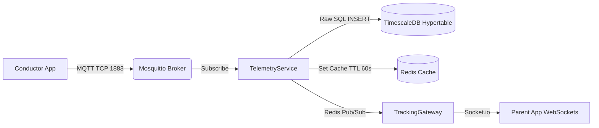

# TheMinaker Backend - Current Status & Architecture Report

**Purpose of this document:** This artifact is designed to be fed into an LLM (like Gemini) to provide complete context of the current backend state. It explains the architecture, constraints, implemented features, and missing modules, allowing the LLM to generate highly accurate and context-aware prompts for future development.

---

## 1. Tech Stack & Infrastructure
- **Framework:** NestJS (v10) running on Fastify.
- **Database:** PostgreSQL (v16) with TimescaleDB extension (for GPS hypertable) and PostGIS.
- **ORM:** TypeORM. **CRITICAL CONSTRAINT:** `synchronize: false` is strictly enforced. Schema is managed entirely via raw SQL in `database/schema.sql`.
- **Connection Pooling:** PgBouncer (running in `transaction` mode).
- **Cache & Queues:** Redis (v7) + BullMQ.
- **IoT / Telemetry:** Eclipse Mosquitto (MQTT broker) for high-frequency GPS ingestion from conductor mobile apps.
- **WebSockets:** `@nestjs/websockets` (Socket.io) with Redis Adapter for broadcasting live locations to parents.

---

## 2. Core Architectural Patterns

### Multi-Tenancy & Row-Level Security (RLS)
The platform is a multi-tenant SaaS. Tenant isolation is enforced at the database level using PostgreSQL RLS.
- **Implementation:** `apps/api/src/common/tenant-context.ts` provides a `withTenant()` wrapper.
- **Mechanism:** It creates a dedicated transaction, executes `SELECT set_config('app.current_tenant_id', $1, true)`, and runs the repository queries inside that transaction. This is the **only safe way** to handle RLS through PgBouncer's transaction pool.
- **Usage Rule:** Every service method fetching school data MUST wrap TypeORM queries in `withTenant(this.dataSource, tenantId, (manager) => { ... })`.

### Global Validation & DTOs
- The app uses a global `ValidationPipe` with `whitelist: true` and `forbidNonWhitelisted: true`.
- **Constraint:** All DTOs must use `class-validator` decorators (including `@IsOptional()` for optional fields). Interfaces cannot be used for request body validation.

### Authentication
- JWT-based authentication. Roles include `SUPER_ADMIN`, `SCHOOL_ADMIN`, `TEACHER`, `CONDUCTOR`, `GATEKEEPER`, `PARENT`.
- Guards: `JwtAuthGuard`, `RolesGuard`, and `TenantGuard` (which extracts the tenant ID from the JWT and attaches it to the request).

---

## 3. Telemetry Pipeline (Highly Optimized)
The GPS tracking system bypasses standard ORM overhead for maximum throughput:

1. Mobile app publishes to `minaker/{tenantId}/bus/{busId}/location`.
2. `TelemetryService` reads it, executes a raw SQL insert to the `gps_telemetry` table.
3. Sets `bus:pos:{busId}` in Redis for instant REST API retrieval.
4. Publishes to `tenant:{tenantId}:telemetry` channel, which `TrackingGateway` broadcasts to isolated Socket.io rooms.

---

## 4. Module Status Breakdown

| Module | Status | Description |
| :--- | :--- | :--- |
| **Auth** | 🟡 Partial | Unified login implemented. OTP generation works but currently logs to console. **Missing:** MSG91 SMS gateway integration via BullMQ. |
| **Tenants** | 🟢 Complete | Super-admin CRUD for onboarding schools. Fully isolated. |
| **Users** | 🟢 Complete | Profile fetching (`/me`) and FCM token updates. |
| **Schools** | 🟢 Complete | School admins can fetch and update their school settings. |
| **Fleet** | 🟢 Complete | APIs to fetch buses, routes, and trips. Conductor can `startTrip()` and `endTrip()`. Fully integrated with RLS. |
| **Attendance**| 🟢 Complete | Supports `mark` and `mark-batch` (for offline-first mobile sync). Roster generation works via `getRoster`. |
| **Telemetry** | 🟢 Complete | Ingestion, Redis Caching, and TimescaleDB hypertable inserts are fully operational. |
| **Tracking** | 🟢 Complete | WebSocket Gateway handles authentication, joins tenant rooms, and broadcasts live Redis Pub/Sub events. |
| **Health** | 🟢 Complete | Terminus liveness/readiness checks including Postgres and Heap Memory. |

---

## 5. Missing Features (What Needs to be Built Next)

If you are generating prompts for the AI to continue backend development, focus on these unbuilt features:

### A. Approvals & Change Requests Module
Currently, the Gateman/Admin UI has screens to approve Parent profile edits (e.g., changing phone number, address, or assigned bus stop). 
- **Requirement:** Scaffold an `ApprovalsModule` with a `ChangeRequestEntity`.
- **Flow:** When a parent updates their profile, it should create a `PENDING` record in this table. An endpoint `GET /api/approvals` will list them for the Gateman, and `POST /api/approvals/:id/approve` will merge the changes into the actual `StudentEntity`.

### B. Geofence & Proximity Engine
- **Requirement:** `TelemetryService` currently just saves GPS points. It needs logic to calculate distance.
- **Flow:** When a GPS point is received, calculate the Haversine distance to the bus's assigned route stops. 
- **Triggers:** If the bus is < 1km from a stop, trigger a BullMQ job to send a "Bus Arriving" push notification to parents at that stop. If a student is marked "Dropped Off" > 500m away from their assigned stop, trigger a "Geofence Alert" to the Gateman.

### C. Automated Cron Jobs (BullMQ)
- **Requirement:** A scheduled worker that runs at 4:00 PM (or end of school day).
- **Flow:** Queries all active students. If a student lacks an `attendance_event` for that calendar day, automatically insert an `absent` record.

### D. SMS Gateway Integration
- **Requirement:** Real SMS delivery in `AuthService`.
- **Flow:** Replace the `console.log(otp)` stub with a BullMQ job that calls the MSG91 API to deliver OTPs securely.
